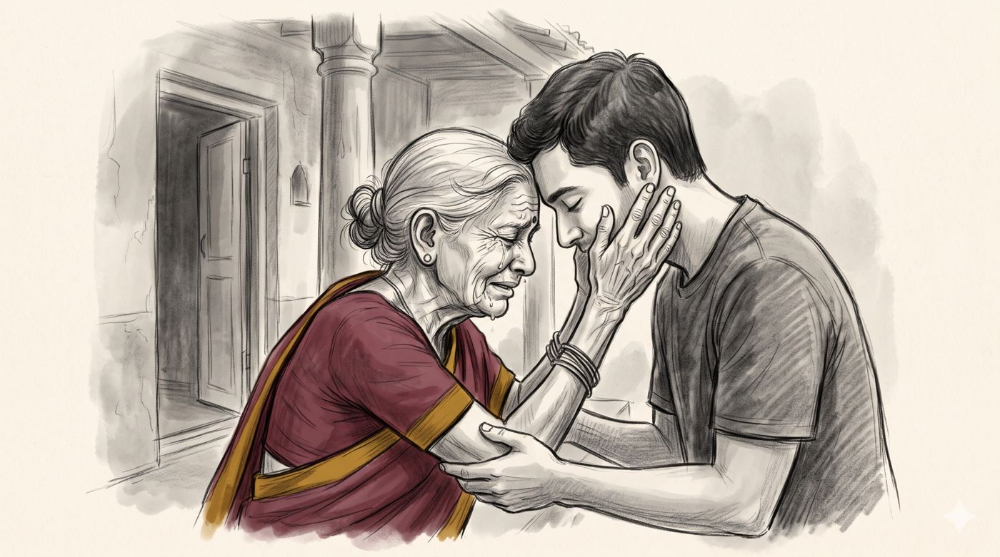
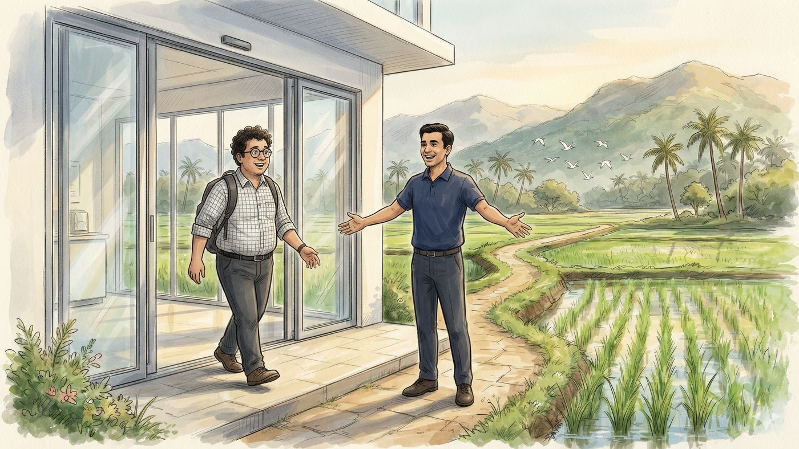

# TAKUMI_Video

Sketch storyboards for the Takumi Motion Controls recruitment film **"Come Back to Your Roots"**.
Open a story and press **Play**: each sketch pops up in film order with its Tamil and English subtitle.

## ▶ Watch the storyboards

| | Story | |
|---|---|---|
|  | **[Story A · Come Back to Your Roots](https://rsk1976.github.io/TAKUMI_Video/story-a/)** As a boy, Arun flew a toy plane with his Paati. Years later he works three hours away and misses every festival, and the night she falls. A Takumi e-plane makes it fifteen minutes, so he goes home every day, then joins the team that builds it. 45 shots · about 1 min 54 s | [Open Story A](https://rsk1976.github.io/TAKUMI_Video/story-a/) |
|  | **[Story B · The Friend Left Behind](https://rsk1976.github.io/TAKUMI_Video/story-b/)** Arun and his best friend Karthik share the city grind. Arun goes home to a world-class lab in Tenkasi; Karthik stays and watches Arun's life on video calls until it breaks him. Then the doors open for him too. 26 shots · about 1 min 9 s | [Open Story B](https://rsk1976.github.io/TAKUMI_Video/story-b/) |

Both stories on one page: **https://rsk1976.github.io/TAKUMI_Video/**

---
Draft storyboards for internal review. Sketches made with Google Gemini from Claude's prompts. Subtitles are drafts.
